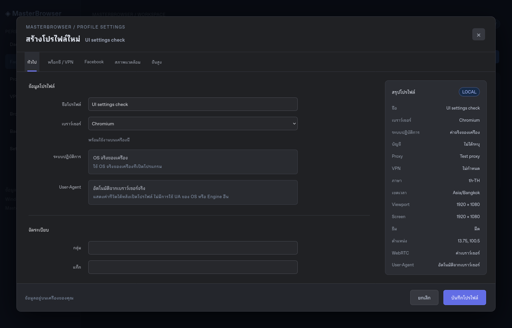
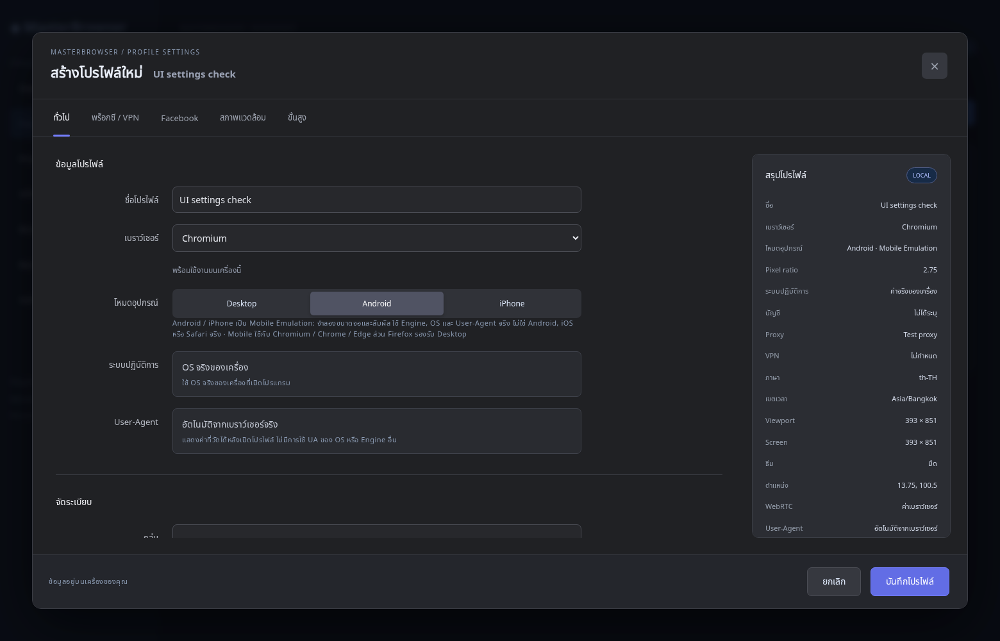

# MasterBrowser

โปรแกรม Desktop ส่วนตัวสำหรับจัดการ Browser Profile ของบัญชี Facebook ที่คุณเป็นเจ้าของ UI ภาษาไทย Dark Mode ใช้ Electron + React + TypeScript + Vite + SQLite + Playwright

## เริ่มบน Windows 10 / 11

ติดตั้ง Node.js 24 LTS แล้วเปิด PowerShell ในโฟลเดอร์โปรเจกต์:

```powershell
npm ci
npx playwright install chromium firefox
npm run desktop
```

Chrome / Edge ใช้ Binary ที่ติดตั้งบนเครื่อง ส่วน Chromium / Firefox ใช้ Binary ของ Playwright รุ่น 0.3.0 ของแพ็กเกจ Windows รวม Binary ไว้ที่ resources/browsers แล้ว ไม่ต้องติดตั้ง Node.js เพื่อใช้ไฟล์ส่งมอบ

```powershell
npm run typecheck
npm run lint
npm test
npm run test:browser
npm run package:win
npm run package:portable
```

ตัวติดตั้งสร้างใน `release/` การสร้าง EXE ที่เชื่อถือได้ควรทำบน Windows และทดสอบติดตั้ง/เปิดจริง ตัวติดตั้งยังไม่ได้ลงลายเซ็นโค้ด

`npm run dev` เปิด Vite สำหรับพัฒนา UI อย่างเดียว ระบบ SQLite/Browser/VPN ต้องเปิดผ่าน `npm run desktop` ซึ่ง Build และเปิด Electron ไม่ใช้ข้อมูล Mock หากเปิด UI ในเว็บปกติจะแจ้งว่าไม่มี Desktop API

## ฟังก์ชันที่มีโค้ดรองรับ

- สร้าง แก้ไข ลบ ทำสำเนาการตั้งค่าโปรไฟล์ พร้อมกลุ่ม แท็ก หมายเหตุ
- แยก userDataDir ด้วย UUID ป้องกันเปิดซ้ำระหว่างกำลังเปิดและขณะทำงาน ปิด Browser ได้จาก UI
- เลือก Chromium / Chrome / Edge / Firefox เปิดหน้าต่างจริงและไป Facebook
- Locale, Timezone, Viewport และ Screen ตามค่าที่กำหนด ใช้ User-Agent จริง ไม่ปลอม Fingerprint หรือ OS
- Proxy HTTP / HTTPS / SOCKS5, Import URL หนึ่งบรรทัดต่อรายการ ข้ามรายการซ้ำ ตรวจรูปแบบและพอร์ต
- ไม่รองรับ SOCKS5 authentication; ข้อมูลรับรองใช้ Electron safeStorage (Windows DPAPI) ไม่ส่งกลับ Renderer
- ทดสอบ Public IP และ Latency ผ่าน Proxy; สุ่มเฉพาะรายการสถานะ available ก่อนเปิดและทดสอบซ้ำก่อนเริ่ม Browser ไม่เปลี่ยน Proxy ระหว่าง Session
- ยกเลิกการสุ่มอัตโนมัติหากต้องการล็อก Proxy ที่เลือก ไม่มีรายการที่ผ่านหรือ Preflight ล้มเหลวจะหยุด ไม่มี Direct fallback
- ตรวจ Public IP สำหรับ Direct Connection ก่อนเปิด Facebook เช่นกัน
- แสดง Windows VPN ที่ตั้งไว้และสถานะจริง เชื่อมต่อ/ตัดด้วย rasdial เฉพาะชื่อที่ตรวจพบ ใช้ข้อมูลรับรองที่ Windows บันทึกไว้ ไม่ส่งรหัสผ่านผ่าน Command Line และมี Windows Settings เป็นทางเลือกเมื่อเชื่อมต่ออัตโนมัติไม่ได้
- สุ่มเลือก VPN จาก Connection ที่ตั้งค่าไว้ได้ใน VPN Manager และหน้าโปรไฟล์ การสุ่มไม่เปลี่ยนการเชื่อมต่อเอง
- เลือก VPN ที่ต้องเชื่อมต่อในโปรไฟล์ ถ้าไม่ Connected จะไม่เปิด Browser; VPN มีผลทั้งเครื่อง
- ตรวจ Public IP ก่อน/หลังเปลี่ยน VPN อัตโนมัติ พร้อมปุ่มตรวจซ้ำแยกต่างหาก
- Backup/Restore JSON ของการตั้งค่าโปรไฟล์ ตรวจ Schema และขนาดไฟล์ สร้าง ID ใหม่ ไม่รับ Path จากไฟล์นำเข้า
- SQLite AppData, sandbox, contextIsolation, contextBridge, IPC allowlist และตรวจ sender/input; ไม่มี Cloud หรือระบบล็อกอินของแอป

การลบโปรไฟล์ลบเฉพาะข้อมูลตั้งค่าและเก็บ Session บนดิสก์ไว้เพื่อป้องกันข้อมูลสูญหาย การทำสำเนาไม่คัดลอก Cookies/Session

## ที่เก็บข้อมูล

Windows: `%APPDATA%/masterbrowser/` (ตำแหน่งจริงตาม Electron userData)

- `masterbrowser.sqlite` และไฟล์ WAL
- `sessions/<uuid>/` แยก Cookies / Cache / Local Storage

ไฟล์ Session เป็นข้อมูลอ่อนไหวของเบราว์เซอร์ ควรปกป้องบัญชี Windows และดิสก์ ไม่มีการบันทึกรหัสผ่าน Facebook ลงฐานข้อมูลแอป

Backup ใน UI **ไม่รวม Session หรือ Proxy Credentials** Restore จะตั้ง Proxy เป็น Direct และปิดการสุ่ม ต้องตรวจและกำหนด Proxy ใหม่ก่อนเปิด

## สถานะการตรวจในคลาวด์

ผ่าน Typecheck, ESLint, Build, Unit Tests 14 รายการ (รวม VPN output/selection, Proxy Import ที่ปฏิเสธ path/query, hostname validation และ SQLite migration ที่ไม่ downgrade ฐานข้อมูลรุ่นใหม่กว่า) และ HTTP smoke ของ Vite

ทดสอบ Firefox 157 จริงแบบ headless ผ่าน: Cookies/Local Storage แยกสองโปรไฟล์, เปิด userDataDir เดิมซ้ำถูกปฏิเสธ และข้อมูลคงอยู่หลังปิด/เปิดใหม่ รวมทั้งยืนยัน Locale th-TH, Timezone Asia/Bangkok, Viewport และ Screen 1280px จริง คำสั่งในคลาวด์:

```bash
XDG_CONFIG_HOME=/workspace/.config XDG_CACHE_HOME=/workspace/.cache PLAYWRIGHT_BROWSERS_PATH=/workspace/.cache/ms-playwright BROWSER_TEST_ENGINE=firefox npm run test:browser
```

การทดสอบ Firefox ต้องรันนอก sandbox ชั้นคำสั่งของคลาวด์ เพื่อให้ sandbox ของ Firefox เขียน `/proc/self/uid_map` ได้ ไม่ได้ปิด sandbox ของ Firefox

ยังไม่ยืนยัน Electron Desktop E2E: การทดสอบโหมด headless ของ Electron ใน Linux ออกจากโปรแกรมด้วยข้อผิดพลาดด้าน display จึงยังต้องทดสอบบนเครื่องที่มี GUI ส่วน Chromium ดาวน์โหลดไม่ได้เพราะ redirect ไป `storage.googleapis.com` ที่ยังรอการใช้การตั้งค่าเครือข่ายใหม่

ต้องทดสอบบน Windows: เปิด/ปิดทุก Engine, Proxy จริงพร้อม credentials, VPN status/connection, DPAPI, Backup/Restore UI, ติดตั้งและเปิด EXE

ยังไม่มี DNS/WebRTC leak diagnostics, Network kill switch, ข้อมูลประเทศ IP, User-Agent override และ Full Session Backup ไม่รับรองป้องกัน IP leak 100% ไม่ใช้เลี่ยง CAPTCHA, แบน หรือข้อจำกัด Meta

## เครือข่ายที่จำเป็น

ติดตั้ง: registry.npmjs.org, github.com และโดเมน GitHub release, cdn.playwright.dev, storage.googleapis.com และโดเมน Microsoft download ที่ redirect ไป

ทำงาน: api.ipify.org สำหรับ IP check; www.facebook.com และโดเมนทรัพยากรของ Facebook ตามการใช้งานจริง รวมถึงปลายทาง Proxy ของผู้ใช้ บนเครื่อง Windows ใช้นโยบายเครือข่ายของเครื่องนั้น

## การพัฒนาในคลาวด์

ใช้ checkout ที่ `/workspace/adspower` ซึ่งแยกสภาพแวดล้อมไว้แล้ว ไม่ต้องสร้าง Git worktree เพิ่ม ตั้ง `PLAYWRIGHT_BROWSERS_PATH=/workspace/.cache/ms-playwright` ให้ตรงกับตำแหน่งติดตั้งในคลาวด์

## ไฟล์ที่สร้างในการส่งมอบนี้

`release/MasterBrowser-0.2.0-win.zip` เป็นแพ็กเกจ Windows แบบแยกไฟล์ ให้แตก ZIP ทั้งหมดและเปิด `MasterBrowser.exe` อย่าคัดลอกเฉพาะ EXE ออกไป Chromium/Firefox ต้องติดตั้ง Binary ตามคำสั่งด้านบน หรือเลือก Chrome/Edge ที่มีอยู่แล้ว

ตรวจโครงสร้าง PE, app.asar, Main, Preload และ dependency ที่แพ็กแล้วผ่าน แต่ยังไม่ได้เปิดแอปนี้บน Windows จริง การสร้าง NSIS Installer บน Linux ล้มเหลวเพราะ Wine toolset โหลด ntdll ไม่สำเร็จ จึงไม่ส่งมอบไฟล์ Installer ที่สร้างค้างไว้

มี `.github/workflows/windows.yml` สำหรับตรวจบน Windows รวม Browser Session integration, Packaging และเปิดแพ็กเกจด้วย `--smoke-test` (ตรวจ UI โหลดและ IPC/SQLite ตอบกลับ) Workflow นี้ยังไม่ได้รันบน GitHub

## รุ่น 0.2.0

เพิ่มการเชื่อมต่อ/ตัด VPN และสุ่มเลือก Configuration พร้อมแสดง IP ก่อน/หลัง ใช้ `rasdial.exe` ผ่าน argument array เฉพาะชื่อที่ตรวจพบ ไม่มีคำสั่ง shell หรือรหัสผ่าน และต้องยืนยันใน UI ก่อนเปลี่ยนเครือข่ายทั้งเครื่อง หากยืนยันสถานะไม่ได้จะแสดงข้อผิดพลาดและให้เชื่อมต่อผ่าน Windows Settings

ปรับ Proxy ที่ล้มเหลวระหว่างเปิดโปรไฟล์ให้เป็นสถานะ failed เพื่อไม่ให้ถูกสุ่มในครั้งต่อไป ตรวจ hostname และ URL import เข้มงวดขึ้น พร้อมป้องกัน SQLite รุ่นใหม่ถูก downgrade

Unit Tests ของ VPN ตรวจ parser และการเลือก Connection เท่านั้น ยังไม่ใช่หลักฐานว่า Windows VPN เชื่อมต่อจริงได้บนเครื่องคลาวด์นี้

แพ็กเกจ Windows ZIP 0.2.0 สร้างผ่านด้วย electron-builder target zip ตรวจ CRC ทุกไฟล์ และตรวจ Main/Preload/โมดูลที่แพ็กให้ตรงกับ Build ล่าสุดแล้ว มี SHA-256 ในไฟล์ .sha256 ข้าง ZIP ผลนี้ยังไม่ใช่การทดสอบเปิดแอปบน Windows

## ดาวน์โหลดจาก GitHub Actions

เปิด https://github.com/masterworldbet/adspower/actions แล้วเลือกรายการล่าสุดของ **Build MasterBrowser for Windows** รอขั้นตอน Upload portable application สำเร็จ จากนั้นเลื่อนลงไปที่ **Artifacts** และกด **MasterBrowser-Windows-Portable** (ต้องล็อกอิน GitHub และมีสิทธิ์เข้าถึง repository)

แตก ZIP ทั้งหมดและเปิด MasterBrowser.exe จากโฟลเดอร์ที่แตกไฟล์ ส่วน MasterBrowser-Windows-Installer จะปรากฏหลัง Desktop smoke test และการสร้างตัวติดตั้งผ่านแล้ว ไฟล์ Artifacts เก็บ 14 วัน สามารถกด Run workflow เพื่อสร้างใหม่ได้ หาก workflow ล้มเหลวให้ดูขั้นตอนที่เป็นสีแดงก่อนถือว่าโปรแกรมผ่านการตรวจสอบ

การทดสอบ Browser กำหนดเวลาสูงสุด 60 วินาที ปิด HTTP connections หลังทดสอบ และตรวจตัวป้องกันการเปิดโปรไฟล์ซ้ำของแอปโดยตรง GitHub Actions แยก Browser validation (Chromium/Firefox) จากงานสร้างแพ็กเกจ แต่ยังรายงานผลทดสอบที่ล้มเหลวตามจริง

## รุ่น 0.3.0 — Browser ที่พร้อมใช้งานในแพ็กเกจ

แพ็กเกจ Windows รวม Chromium และ Firefox แล้ว แตกไฟล์ทั้งหมดรวม resources/browsers ก่อนเปิดแอป Chrome/Edge ใช้ Binary ที่ติดตั้งบนเครื่อง โดยค้นหา Program Files, Program Files (x86), ProgramW6432 และ LocalAppData แล้วเปิดด้วย executablePath ที่พบจริง หากไม่พบจะแจ้งชื่อเบราว์เซอร์และวิธีแก้ก่อนเริ่มตรวจเครือข่าย

Browser Settings แสดงสถานะและตำแหน่ง Binary ข้อผิดพลาดการเปิดโปรไฟล์แยกช่วง configuration, IP preflight, browser startup และ Facebook navigation และไม่แสดง raw error ที่อาจมีข้อมูลรับรอง Proxy

ก่อนสร้างแพ็กเกจเองบน Windows ให้ติดตั้ง Binary ลงโฟลเดอร์ที่จะรวมในแพ็กเกจ:

```powershell
$env:PLAYWRIGHT_BROWSERS_PATH = "$PWD/browser-binaries"
npx playwright install chromium firefox
npm run package:portable
npm run package:win
```

CI ทำขั้นตอนนี้ก่อนแพ็ก และ smoke test เปิด Chromium/Firefox จากแพ็กเกจจริง รวมทั้ง Chrome/Edge ที่ตรวจพบใน Windows runner กับหน้าในเครื่อง ไม่เปิดบัญชี Facebook ระหว่างทดสอบ

## รุ่น 0.4.0 — หน้าตั้งค่าโปรไฟล์แบบแท็บ



แท็บทั่วไป, พร็อกซี / VPN, Facebook, สภาพแวดล้อม และขั้นสูง พร้อมสรุปค่าด้านขวาที่อัปเดตทันที ช่องตั้งค่าที่เปลี่ยนได้เชื่อมกับ Playwright จริง:

- ภาษา/Locale, Timezone, ธีมเว็บไซต์ และ Preset ความละเอียด Windows Desktop
- Viewport และ Screen แยกกัน โดย Screen ต้องไม่น้อยกว่า Viewport
- Geolocation ใช้ค่าเบราว์เซอร์, ปิดกั้น หรือกำหนดละติจูด/ลองจิจูดและ accuracy ใช้สิทธิ์เฉพาะ origin ของหน้า Facebook ที่ตั้งไว้ ไม่เปลี่ยน Public IP
- WebRTC default หรือ disable_non_proxied_udp บน Chromium/Chrome/Edge ตาม browser policy จริง ไม่ใช่ Kill Switch และไม่อ้างว่าป้องกัน leak ได้ทั้งหมด Firefox ปฏิเสธ option นี้อย่างชัดเจน
- URL เริ่มต้นหลายแท็บ (สูงสุด 10) รองรับเฉพาะ HTTPS บน facebook.com และ subdomain ไม่มี URL ที่ฝัง credentials
- ชื่อบัญชีสำหรับอ้างอิงเท่านั้น ลงชื่อเข้าใช้ผ่านเบราว์เซอร์ ไม่รับรหัสผ่านหรือคีย์ 2FA ในฟอร์ม
- ค่าที่ตรวจวัดจาก browser ครั้งล่าสุด เช่น User-Agent แสดงแยกจากค่าที่กำลังตั้ง

OS, GPU, WebGL, WebGPU, Canvas, AudioContext, Fonts และ Media Devices ใช้ค่าจริง/ค่าเริ่มต้นของเครื่อง ไม่มีปุ่มปลอม fingerprint, เติม noise หรือสุ่มข้อมูลฮาร์ดแวร์

ผ่าน Unit Tests 22 รายการ และ UI integration ที่ทดสอบการเปลี่ยนแท็บ/สรุป/ปฏิเสธ URL/บันทึกหลายค่า ในชุด UI test เท่านั้นจะมี IPC fixture เพื่อทดสอบ React โดยไม่แตะบัญชีจริง Production ไม่มี Mock Data อีกชุดทดสอบ Firefox จริงตรวจ Geolocation, Dark theme, Locale, Timezone, Viewport, Screen และ persistent session isolation พร้อมกัน คำสั่ง:

```powershell
npm test
npm run test:browser
npm run test:ui
```

Windows CI รันทดสอบ Browser และ UI ทั้ง Chromium/Firefox ก่อนเผยแพร่ไฟล์รุ่นใหม่

## รุ่น 0.5.0 — Desktop / Android / iPhone



เลือกโหมดอุปกรณ์ในแท็บทั่วไปแยกแต่ละโปรไฟล์:

- Desktop: หน้าต่างปกติ ไม่มี Touch emulation
- Android: Mobile Emulation 393×851, Touch, Pixel ratio 2.75
- iPhone: Mobile Emulation 390×844, Touch, Pixel ratio 3

โหมดมือถือใช้ Chromium / Chrome / Edge ส่วน Firefox รองรับเฉพาะ Desktop UI และ backend ตรวจข้อจำกัดนี้ตรงกัน ไม่มีการสลับ Engine โดยไม่แสดงให้ทราบ

โหมดนี้จำลอง viewport, touch, mobile layout และความหนาแน่นพิกเซลเท่านั้น ใช้ User-Agent และ Engine จริง ไม่อ้างว่า Windows เปลี่ยนเป็น Android/iOS หรือ Chrome เปลี่ยนเป็น Safari บางเว็บที่เลือกหน้าเว็บจาก User-Agent อาจยังให้หน้า Desktop ได้แม้หน้าจอเป็น Mobile สามารถตั้ง URL เริ่มต้นเป็น https://m.facebook.com/ ได้ตามการรองรับของเว็บไซต์

ทดสอบ Chromium จริงทั้งสองโหมด: viewport, screen, devicePixelRatio, touch points และการ tap ปุ่ม พร้อมยืนยันว่าไม่ได้ใช้ User-Agent ปลอมของ Android/iPhone อีกทั้ง UI test ตรวจการเลือกและบันทึกโหมด Android/iPhone สำเร็จ โปรไฟล์เก่าจะมี deviceMode=desktop โดยอัตโนมัติ

### ขอบเขต VPN

MasterBrowser สุ่มเลือกและสั่งเชื่อมต่อ Windows VPN ที่ผู้ใช้ตั้งไว้ได้ แต่เส้นทางเครือข่ายของ VPN แบบนี้มีผลกับทั้งเครื่อง ส่วนการสุ่ม Proxy แยกโปรไฟล์รองรับอยู่แล้ว การแยก VPN จริงคนละตัวต่อโปรไฟล์ทำได้ทางเทคนิคด้วยระบบแยก routing เพิ่มเติม ซึ่งแอปยังไม่ได้พัฒนาส่วนนั้น ข้อจำกัดนี้ไม่ได้หมายความว่าโปรแกรมอื่นไม่สามารถทำได้
